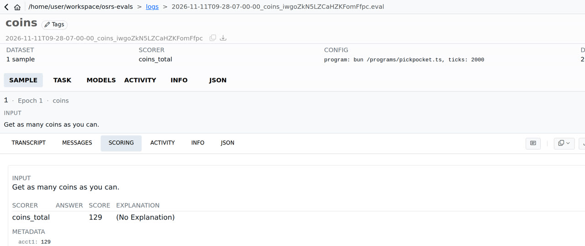
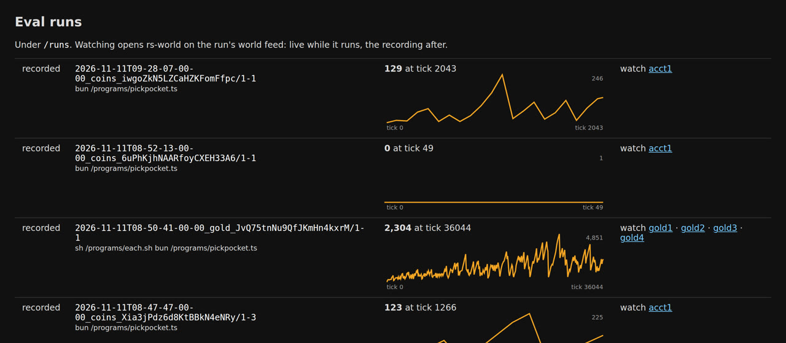

# osrs-evals

Evals in RuneScape, on [Inspect AI](https://inspect.aisi.org.uk/) and Max Bittker's
[rs-sdk](https://github.com/MaxBittker/rs-sdk) (a 2004scape server with its gameplay tweaks: faster
XP, infinite run energy, no random events).

Inspect does the eval framework: tasks, scoring, repeats, limits, parallel samples, sandboxes (where
it runs), logs and the log viewer. This repo adds only the RuneScape parts. The harness does three
things and knows nothing about how a program organises itself:

1. **sets up an eval**: a fresh world with the eval's settings, its accounts' start saves, a tick budget
2. **runs whatever program it is pointed at** with those accounts and the goal, and stops it at the budget
3. **records what happens in the game**: the eval's score over time, read from the server, and the
   world feed, which you can watch live or replay in 3D with Max's [rs-world](https://github.com/MaxBittker/rs-world)

## The whole simple example

**The eval:** one account in Lumbridge, 2,000 engine ticks (100 s at 20 ticks a second, 8× normal speed), scored by the coins it
holds at the end. **The program:** pickpocket men forever.

### The files

`evals/coins.py`, the eval and how it is scored:

```python
from inspect_ai import Task, task
from inspect_ai.dataset import Sample
from inspect_ai.scorer import Score, mean, scorer

from harness import read_saves, run_program


def coins_held(accounts):
    """Coins the accounts hold, in their inventories and banks."""
    return sum(a["inv"].get("995", 0) + a["bank"].get("995", 0) for a in accounts.values())


@task
def coins(program: str = "bun /programs/pickpocket.ts", ticks: int = 2000):
    return Task(
        dataset=[
            Sample(
                input="Get as many coins as you can.",
                metadata={
                    "accounts": [{"username": "acct1", "save": "lumbridge.sav"}],
                    "world": {"NODE_TICKRATE": "50", "GE_ENABLED": "false"},
                    "budget_ticks": ticks,
                },
            )
        ],
        solver=run_program(program, track=coins_held),
        scorer=coins_total(),
        sandbox=("docker", "compose.yaml"),
    )


@scorer(metrics=[mean()])
def coins_total():
    async def score(state, target):
        accounts = await read_saves(state)  # the server's saves, written at logout
        return Score(value=coins_held(accounts), metadata={name: coins_held({name: a}) for name, a in accounts.items()})

    return score
```

`programs/pickpocket.ts`, the program. It knows nothing about Inspect; it reads its accounts from `$EVAL`:

```ts
import { runScript } from '/opt/sdk/runner';

const { accounts } = await Bun.file(process.env.EVAL!).json();
process.env.BOT_USERNAME = accounts[Number(process.env.ACCOUNT ?? 0)].username;
process.env.PASSWORD = accounts[Number(process.env.ACCOUNT ?? 0)].password;

await runScript(async ({ bot }) => {
    for (;;) await bot.pickpocketNpc(/^man$/i);
});
```

`saves/make.ts`, the start state, made once with rs-sdk's own save generator (`saves/lumbridge.sav` is committed):

```ts
import { createSaveData } from '/opt/sdk/test/utils/save-generator';

// A new character in Lumbridge, next to the men by the castle.
await Bun.write(`${import.meta.dir}/lumbridge.sav`, createSaveData({ position: { x: 3231, z: 3218 } }));
```

`evals/compose.yaml`, where it runs (a local Docker; another place is another file, chosen with `--sandbox`):

```yaml
services:
  default:
    image: rs-evals-world:71d949d
    init: true
    ports:
      - "8888"   # the engine's web port (world feed, /mapview) on a free host port
```

### The one command

```sh
PYTHONPATH=. inspect eval evals/coins.py --model none
```

It took 2 minutes on a 2-CPU VM. Inspect prints:

```text
╭──────────────────────────────────────────────────────────────────────────────╮
│coins (1 sample): none/none                                                   │
╰──────────────────────────────────────────────────────────────────────────────╯
total time:                                   0:02:00
coins_total
mean         129.000
Log: logs/2026-11-11T09-28-07-00-00_coins_iwgoZkN5LZCaHZKFomFfpc.eval
```

In those 2 minutes Inspect starts a fresh container from `compose.yaml`, and `run_program`:

1. copies in `harness/`, `saves/` and `programs/`, puts `lumbridge.sav` in the engine's players folder as `acct1`,
   and starts rs-sdk's engine and gateway with the eval's `world` settings (about 8 s)
2. logs `acct1` in with rs-sdk's headless client (about 4 s), writes `$EVAL`, and starts the program
3. every 100 ticks reads the account from the server's own save and records the eval's measure (`track=coins_held`)
4. at 2,000 engine ticks stops the program, clicks each account's logout button so the server saves it, and
   scores from that save. Here the score, 129, is what the program itself last saw in its inventory.

`--model none` means there is no model; see below for a program that uses one.

### What comes out

**The Inspect log** (`inspect view`): the score and config, then the sample. Its transcript has every
step, where the live world feed is while it runs, and the coins every 100 ticks ("score over time").
The scoring tab has the score per account. The sample metadata has the program's exit, how it was
stopped, its last output, and the whole timeline.




**The run folder** next to the log, `logs/<log name>/<sample>-<epoch>/`: `world.jsonl.gz` (the
recorded world feed, 225 KB here), `sample.json` (settings, program result, timeline),
`program.log`, and the engine's and clients' logs.

**The game view** (`viewer/`, below): every run with its score over time, and rs-world following an
account, live or replayed. In this run the coins climb, then fall back now and then; the men hit back
and the account's HP runs low, so it most likely dies and drops them (not checked).




## Setup, once per machine

```sh
image/build.sh                                  # the world image: rs-sdk at 71d949d, ~3 min
docker build -f viewer/Dockerfile -t rs-evals-viewer:71d949d .   # the game view (rs-world), ~5 min
python -m venv .venv && . .venv/bin/activate && pip install inspect_ai
pip install anthropic openai                    # only to run programs that call a model
```

To regenerate the start saves: `docker run --rm --user $(id -u) -v $PWD/saves:/evals/saves rs-evals-world:71d949d bun /evals/saves/make.ts`.

## Doing more with the same pieces

**Point the same eval at another program.** `programs/llm.ts` has a model play through rs-sdk (it
writes TypeScript against `bot` and `sdk` each turn). Give the eval a model and the harness opens
Inspect's agent bridge, so the program's OpenAI- or Anthropic-style calls reach that model and
Inspect logs each call and its tokens. Nothing in the eval or the harness changes:

```sh
PYTHONPATH=. inspect eval evals/coins.py -T program="bun /programs/llm.ts" --model anthropic/claude-haiku-5-5
```

A program can also call any model itself with its own keys; the harness does not care.

**More accounts.** `evals/gold.py` gives 4 accounts (`-T accounts=N`) 36,000 ticks (30 minutes at 8×)
to hold 100,000 coins between them, and scores the coins at the end and the first tick they
reached the target, read off the score over time. `programs/each.sh` runs a one-account program
once per account:

```sh
PYTHONPATH=. inspect eval evals/gold.py --model none
```

**Repeats and parallel runs.** Every sample gets its own world on its own free host port, so
Inspect's own flags work: `--epochs 5 --max-samples 3`.

**Watch the game.** Run the viewer next to the logs and open http://localhost:7576:

```sh
docker run --rm --network host -v $PWD/logs:/runs:ro rs-evals-viewer:71d949d
```

It lists every sample under `logs/` with its score over time; "watch" opens rs-world following an
account: the live world while the sample runs, its recording afterwards (`?speed=4` on the feed URL
plays faster, `?from=<tick>` skips ahead).

**Where it runs.** The harness copies `harness/`, `saves/` and `programs/` into the sandbox, so
another place to run needs only the world image: for example `--sandbox k8s:values.yaml` with
Inspect's k8s sandbox package. Nothing in the evals or the harness names a host.

## The contract with a program

- **Input:** `$EVAL` is a JSON file with `goal`, `accounts` (username and password), `gateway`
  (rs-sdk's gateway URL), `budget_ticks`, `tick_ms` and `out` (a folder kept with the run). Each
  account is already in the game through rs-sdk's headless client, so the program connects to it
  with the SDK, as rs-sdk's own scripts do.
- **A model, if the eval has one:** `OPENAI_BASE_URL` and `ANTHROPIC_BASE_URL` point at it (any
  model name works).
- **Stop:** SIGTERM to the program's whole process group when the tick budget runs out, SIGKILL
  10 s later. The program's output goes to the run's `program.log`.

## How it works

| File | What it does |
| --- | --- |
| `harness/__init__.py` | `run_program`, the one solver: copies the files in, starts the world, logs the accounts in, starts the program, samples the score every 100 ticks until the budget, stops the program, logs everyone out with the game's logout button (the server saves at once), copies the run out next to the Inspect log. `read_saves` for scorers. |
| `harness/saves.ts` | Reads an account from the server's save file: position, skills, varps (quest progress), inventory, worn items and bank. |
| `harness/sample.ts` | The engine's tick and every account's latest save. The world image lets the harness set the engine's autosave interval, so this is the score over time. |
| `harness/record.ts` | Records the engine's world feed around the accounts (it follows them), plus the all-player roster. |
| `harness/logout.ts`, `client.sh`, `start-world.sh`, `run.sh`, `stop.sh` | The steps above. |
| `image/` | The world image: rs-sdk's own server image at a pinned commit, plus its pathfinding data and a settable autosave interval. |
| `viewer/` | rs-world built against the same map cache, and `serve.ts`: the run list, the live feed proxy and the replay. |

Licences: rs-sdk is MIT and rs-world is BSD-2-Clause; both are built from their repositories at
pinned commits, not copied in. Nothing comes from RuneBench, which has no licence file.

## Status

Verified by running, in a 2-CPU, 4 GB Linux VM with Docker, Inspect 0.3.289 and rs-sdk 71d949d:

| What | How it was checked |
| --- | --- |
| The simple example | `inspect eval evals/coins.py --model none`, above. The final score matches the program's own last report: logout now follows the stop at once, and the save is written within seconds. |
| Score over time | Every sample: the eval's measure per account every 100 ticks, in the transcript and the sample's metadata, and drawn in the viewer. |
| Recording and replay | The world feed around the accounts is saved with each sample (about 135 KB gzipped per minute for one account) and replayed into rs-world at the recorded pace, 4× faster, or from a later tick. |
| Live 3D view | rs-world, served by the viewer, followed `acct1` live through the viewer's feed proxy during a run. |
| More than one account | `evals/gold.py`: 4 accounts in one world, each scored and logged out. The full default (4 accounts, 36,000 ticks) ran in 34 min 48 s: all 4 accounts logged out and saved, 350 timeline points, 2,304 coins at the end (peak 4,851). The pickpocket script is a baseline, not a strategy, so it did not reach 100,000. |
| An LLM program on the same eval | `-T program="bun /programs/llm.ts" --model anthropic/claude-haiku-5-5`: 26 model calls in 2,400 ticks, every call and its tokens in the Inspect log. It scored 2 coins; the script scores around 100. |
| Parallel samples | `--epochs 3 --max-samples 3`: three worlds at once on three free host ports, three recordings. |

Not verified:

- **Other places to run.** Only the local Docker sandbox has run. The harness uses only Inspect's
  sandbox calls (exec, file copy and, for the live view, published ports), so k8s or EC2 should need
  only the world image in a registry and a sandbox config, but that is untested.
- **Speed under load.** The budget is in engine ticks, so a slow engine plays the same game, only
  slower. The Gold run on 2 CPUs ran at about 60% of its 20 ticks per second. A sample is stopped
  anyway after twice its budget in wall-clock time.
- **Recording area.** The recorder follows the accounts but the engine's feed caps one area at
  384×384 tiles. Accounts spread further apart are recorded as dots from the roster, not in full.
