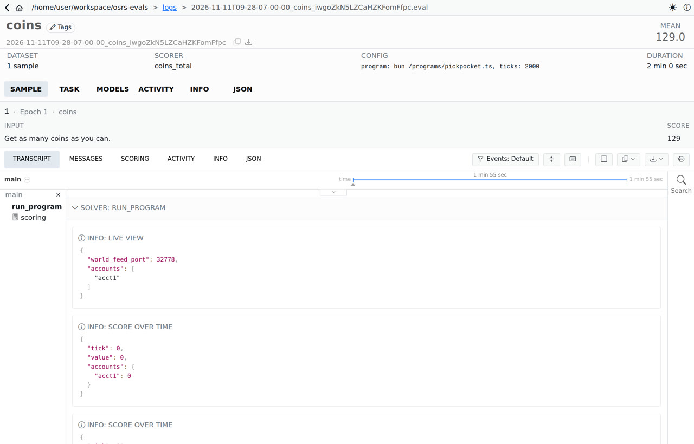
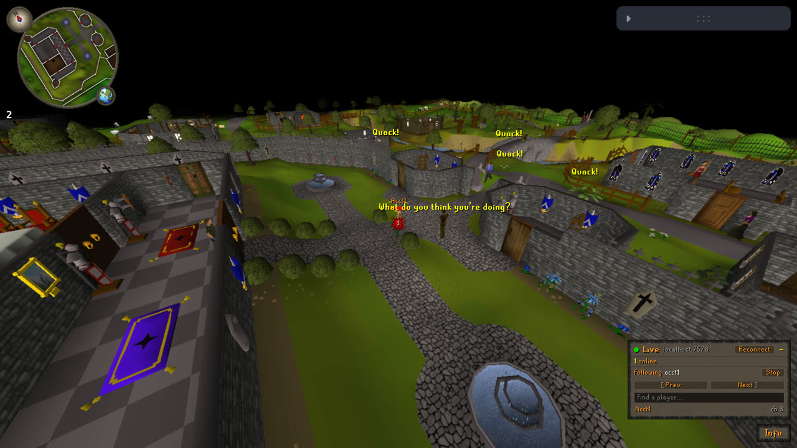

# osrs-evals

Evals in RuneScape, on [Inspect AI](https://inspect.aisi.org.uk/) and Max Bittker's
[rs-sdk](https://github.com/MaxBittker/rs-sdk) (a 2004scape server with its gameplay tweaks: faster
XP, infinite run energy, no random events).

Inspect does the eval framework: tasks, scoring, repeats, limits, parallel samples, the agent, the
model, where it runs, logs and the log viewer. This repo adds only the game:

1. **an eval is a world, accounts and a score.** `game()`, a task's setup step, starts a fresh world
   with the eval's settings and its accounts' start saves, logs the accounts in, and tells the agent
   what it has. Scorers read the result from the server's own saves.
2. **the agent is any Inspect agent**, chosen with `--solver`: a model with a shell, Claude Code,
   Codex, OpenCode, or `command()`, which runs any program (a script, a swarm, another agent's CLI)
   with the accounts in `$EVAL`. The game does not know or care which.
3. **the game is recorded**: the eval's measure over time, read from the server, and the world feed,
   which you can watch live or replay in 3D with Max's [rs-world](https://github.com/MaxBittker/rs-world).
   The game ends at the eval's tick budget, or as soon as its done condition holds, whatever the
   agent is doing.

## The whole simple example

**The eval:** one account in Lumbridge, 2,000 engine ticks (100 s at 20 ticks a second, 8× normal
speed), scored by the coins it holds at the end. **The agent:** a 9-line script that pickpockets men forever.

### The files

`evals/coins.py`, the eval and how it is scored:

```python
from inspect_ai import Task, task
from inspect_ai.dataset import Sample
from inspect_ai.scorer import Score, mean, scorer

from harness import command, game, read_saves


def coins_held(accounts):
    """Coins the accounts hold, in their inventories and banks."""
    return sum(a["inv"].get("995", 0) + a["bank"].get("995", 0) for a in accounts.values())


@task
def coins(ticks: int = 2000):
    return Task(
        dataset=[
            Sample(
                input="Get as many coins as you can.",
                metadata={
                    "accounts": [{"username": "acct1", "save": "lumbridge.sav"}],
                    "world": {"NODE_TICKRATE": "50", "GE_ENABLED": "false"},
                    "budget_ticks": ticks,
                },
            )
        ],
        setup=game(track=coins_held),
        solver=command("bun /programs/pickpocket.ts"),  # the default agent; --solver picks another
        scorer=coins_total(),
        sandbox=("docker", "compose.yaml"),
    )


@scorer(metrics=[mean()])
def coins_total():
    async def score(state, target):
        accounts = await read_saves(state)  # the server's saves, once the game is over
        return Score(value=coins_held(accounts), metadata={name: coins_held({name: a}) for name, a in accounts.items()})

    return score
```

`programs/pickpocket.ts`, the program. It knows nothing about Inspect; it reads its accounts from `$EVAL`:

```ts
import { runScript } from '/opt/sdk/runner';

const { accounts } = await Bun.file(process.env.EVAL!).json();
process.env.BOT_USERNAME = accounts[Number(process.env.ACCOUNT ?? 0)].username;
process.env.PASSWORD = accounts[Number(process.env.ACCOUNT ?? 0)].password;

await runScript(async ({ bot }) => {
    for (;;) await bot.pickpocketNpc(/^man$/i);
});
```

`saves/make.ts`, the start state, made once with rs-sdk's own save generator (`saves/lumbridge.sav` is committed):

```ts
// Builds the start saves with rs-sdk's own save generator (MIT). Run inside the world image:
//   docker run --rm --user $(id -u) -v $PWD/saves:/evals/saves rs-evals-world:71d949d bun /evals/saves/make.ts
import { createSaveData } from '/opt/sdk/test/utils/save-generator';

// A new character in Lumbridge, next to the men by the castle.
await Bun.write(`${import.meta.dir}/lumbridge.sav`, createSaveData({ position: { x: 3231, z: 3218 } }));
```

`evals/compose.yaml`, where it runs (a local Docker; another place is another file, chosen with `--sandbox`):

```yaml
# Where the evals run: one container per sample on the local Docker. The harness copies in what
# it needs, so another place to run (a k8s cluster, EC2) only needs this image; choose it with
# --sandbox.
services:
  default:
    image: rs-evals-world:71d949d
    init: true
    ports:
      - "8888"   # the engine's web port (world feed, /mapview) on a free host port
```

### The one command

```sh
PYTHONPATH=. inspect eval evals/coins.py --model none
```

It takes 2 minutes on a 2-CPU VM. Inspect prints:

```text
╭──────────────────────────────────────────────────────────────────────────────╮
│coins (1 sample): none/none                                                   │
╰──────────────────────────────────────────────────────────────────────────────╯
total time:                                   0:02:00
coins_total
mean         15.000
Log: logs/2026-11-11T11-58-23-00-00_coins_5oLB7WzvzsiNQZLLyefLrr.eval
```

In those 2 minutes Inspect starts a fresh container from `compose.yaml`, and:

1. `game()` copies in `harness/`, `saves/` and `programs/`, puts `lumbridge.sav` in the engine's
   players folder as `acct1`, starts rs-sdk's engine and gateway with the eval's `world` settings
   (about 8 s), and logs `acct1` in with rs-sdk's headless client (about 4 s)
2. the agent, `command(...)`, starts the program with `$EVAL`
3. every 100 ticks the harness reads the account from the server's own save and records the eval's
   measure (`track=coins_held`)
4. at 2,000 engine ticks it stops the program, clicks the account's logout button so the server
   saves it, and the scorer reads that save. The score, 15, is what the program itself last saw.
   The coins went up and down all run (peak 180): the men fight back, the account dies, and its
   coins drop to the ground.

`--model none` means there is no model; see "Swapping the agent" for agents that use one.

### What comes out

**The Inspect log** (`inspect view`): the score and config, then the sample. Its transcript has every
step, where the live world feed is while it runs, the coins every 100 ticks ("score over time") and
"game over" (how it ended, ticks, seconds, the logout). The scoring tab has the score per account.




**The run folder** next to the log, `logs/<log name>/<sample>-<epoch>/`: `world.jsonl.gz` (the
recorded world feed), `sample.json` (settings, how the game ended, timeline), `program.log` for a
`command()` agent, and the engine's and clients' logs.

**The game view** (`viewer/`, below): every run with its score over time, and rs-world following an
account, live or replayed.




## Setup, once per machine

```sh
image/build.sh                                  # the world image: rs-sdk at 71d949d, ~3 min
docker build -f viewer/Dockerfile -t rs-evals-viewer:71d949d .   # the game view (rs-world), ~5 min
python -m venv .venv && . .venv/bin/activate && pip install inspect_ai
pip install anthropic openai inspect_swe        # model providers, and the CLI coding agents
```

To regenerate the start saves: `docker run --rm --user $(id -u) -v $PWD/saves:/evals/saves rs-evals-world:71d949d bun /evals/saves/make.ts`.

## Swapping the agent

The agent is the task's `solver`, and `--solver` replaces it without touching the eval. Every
agent starts with the same thing: the eval's goal and a note on the machine it is on (the accounts,
the budget, rs-sdk at `/opt/sdk` and its docs). From there it works however it works. The model
agents below play by writing a TypeScript script against rs-sdk, running it, reading what happened,
and writing the next one, until the goal is met or the budget runs out.

`evals/cooks_assistant.py` is "complete Cook's Assistant as fast as you can": one new character,
12,000 ticks, done as soon as the server's quest variable says complete, scored by the tick (and
wall-clock seconds) it got there. Its default agent is a model with a shell (Inspect's `react` with
the `bash` tool):

```sh
PYTHONPATH=. inspect eval evals/cooks_assistant.py --model anthropic/claude-haiku-5-5
PYTHONPATH=. inspect eval evals/cooks_assistant.py --model anthropic/claude-haiku-5-5 --solver inspect_swe/claude_code
PYTHONPATH=. inspect eval evals/cooks_assistant.py --model openai/<model> --solver inspect_swe/codex_cli -S version=0.130.0
```

Any other agent or program goes through `command()`, which runs it with `$EVAL` (below) and, when
the eval has a model, with `OPENAI_BASE_URL` and `ANTHROPIC_BASE_URL` pointing at Inspect's agent
bridge, so its calls reach `--model` and are logged:

```sh
PYTHONPATH=. inspect eval evals/cooks_assistant.py --model anthropic/claude-haiku-5-5 \
  --solver harness/__init__.py@command -S cmd="my-agent-cli --prompt \"\$(jq -r .goal \$EVAL)\""
```

A CLI that isn't in the world image has to be installed in it (or in a derived image) first.

Which model, and which provider account pays for it, is not in this repo: it is `--model` plus
Inspect's usual provider settings (such as `ANTHROPIC_BASE_URL` and `ANTHROPIC_API_KEY`) in the
environment where you run `inspect`.

## Comparing agents and models

A set of runs is a file of tasks, one per variant, and Inspect's `eval-set`. `evals/matrix.py` has
Cook's Assistant (one try, and five tries), 500 shrimps, and each with three agents (a model with a
shell, Claude Code, Codex) plus a scripted shrimps baseline. The models are given at run time, so
the same file compares models too (`--model a,b`):

```sh
PYTHONPATH=. inspect eval-set evals/matrix.py --model anthropic/claude-haiku-5-5 --log-dir logs/cooks-haiku
```

Run it again on the same log dir and it runs only what is missing or failed.

## The evals

| Eval | File | What it measures |
| --- | --- | --- |
| Coins | `evals/coins.py` | Coins held after 2,000 ticks. The simple example. |
| Cook's Assistant | `evals/cooks_assistant.py` | Ticks to complete the quest from a new character, read from the quest variable. Done as soon as it is complete. |
| Cook's Assistant, five tries | `cooks_assistant(attempts=5)` | The same, five times in one run: after each try the account is put back at its start save and the agent goes again, keeping its files and context. Scored by the fastest try; every try is recorded. |
| Cook 500 shrimps | `evals/shrimps.py` | Ticks until none of 500 raw shrimps in the bank are left raw. Any model should finish it, so the result is how fast and how cheaply. |
| Gold | `evals/gold.py` | Four accounts, 100,000 coins between them. |

Ideas for more are in `ideas.yaml`.

Every eval says "as fast as you can": the world runs in real time, so the time a model spends
thinking and writing code is game time too. Each run records both clocks: ticks (game time, the
score) and wall-clock seconds, plus the time spent waiting on the model, the tokens, and cost at
list price (`prices.yaml`).

## The site

`site/` is a website for all of it: every eval, variant and run, success CDFs over ticks, seconds
and cost, cost against finish rate, where the time went, and each run's turns, code, screenshot and
3D replay. It is built from the logs:

```sh
python site/export.py logs/<dir> [logs/<dir> ...]       # the logs -> site/public/data
cd site && npm ci && npm run build && cd ..
bun viewer/serve.ts                                       # http://localhost:7576
bun site/capture.ts && python site/export.py logs/<dir>   # screenshots of each run's last moment
```

or in one image: `docker build -f viewer/Dockerfile -t rs-evals-viewer:71d949d .` and
`docker run --network host -v $PWD/site/public/data:/data:ro -v $PWD/logs:/runs:ro rs-evals-viewer:71d949d`.
`site/AGENTS.md` has the rules for changing it.

## Where runs are stored

Each run is one Inspect log (`.eval`) in the log dir: the task and its arguments, the agent and its
arguments, the model, the repo commit, the scores, the score over time, how the game ended and every
model call. Next to it is a folder per sample with the game recording (`world.jsonl.gz`), the
server's and clients' logs and `sample.json`. Inspect View lists and compares runs across all of these.

The log dir is a deployment setting: a local folder (the default, `logs/`, not committed) or any
fsspec location such as `--log-dir s3://bucket/path`, which Inspect and the run folders both write
to. The viewer in `viewer/` reads a local folder only.

## More with the same pieces

**More accounts.** `evals/gold.py` gives 4 accounts (`-T accounts=N`) 36,000 ticks (30 minutes at 8×)
to hold 100,000 coins between them, and scores the coins at the end and the first tick they
reached the target, read off the score over time. Its default agent runs a one-account script once
per account (`programs/each.sh`).

**Repeats and parallel runs.** Every sample gets its own world on its own free host port, so
Inspect's own flags work: `--epochs 5 --max-samples 3`.

**Watch the game.** The site's server relays a running sample's world feed to rs-world, and
replays a finished one's recording (`?speed=4` on the feed URL plays faster, `?from=<tick>` skips
ahead).

**Where it runs.** The harness copies `harness/`, `saves/` and `programs/` into the sandbox, so
another place to run needs only the world image: for example `--sandbox k8s:values.yaml` with
Inspect's k8s sandbox package. Nothing in the evals or the harness names a host.

## What an agent gets

- **The prompt:** the eval's goal, then a note with the accounts, the budget, and how to reach them
  with rs-sdk.
- **The sandbox:** rs-sdk's server, gateway and SDK (`/opt/sdk`, with `README.md` and `API.md`),
  bun, and `/work` to write in. Agents run as an unprivileged `agent` user, so they can play but
  can't edit the server's saves the score is read from. `/work` is kept with the run. Each account is already in the game through rs-sdk's headless
  client, so a script connects to it with the SDK, as rs-sdk's own scripts do.
- **`$EVAL`** (for `command()` programs): a JSON file with `goal`, `accounts` (username and
  password), `gateway`, `budget_ticks`, `tick_ms`, `attempts` and `out` (`/work/out`, kept with the
  run). With several attempts, `/run/attempt.json` says which one is running and how the others went.
- **The end:** at the budget or when the eval is done, the harness stops any `command()` program
  (SIGTERM to its process group, SIGKILL 10 s later), logs every account out, and Inspect scores the
  sample. An agent that finishes earlier ends the game itself.

## How it works

| File | What it does |
| --- | --- |
| `harness/__init__.py` | `game()`, the setup step: copies the files in, starts the world, logs the accounts in, tells the agent, and starts a watchdog that samples the eval's measure every 100 ticks and ends the game at the budget or when done. `read_saves()` for scorers (ends the game first if it is still on). `command()`, the agent that runs a program. |
| `harness/saves.ts` | Reads an account from the server's save file: position, skills, varps (quest progress), inventory, worn items and bank. |
| `harness/sample.ts` | The engine's tick and every account's latest save. The world image lets the harness set the engine's autosave interval, so this is the score over time. |
| `harness/record.ts` | Records the engine's world feed around the accounts (it follows them), plus the all-player roster. |
| `harness/logout.ts`, `client.sh`, `start-world.sh`, `run.sh`, `stop.sh` | The steps above. Logout clicks the game's logout button, so the server saves at once. |
| `image/` | The world image: rs-sdk's own server image at a pinned commit, plus its pathfinding data and a settable autosave interval. |
| `site/` | The website (React, TanStack, ECharts), `export.py` (logs to its data) and `capture.ts` (run screenshots). |
| `viewer/` | `serve.ts`, which serves the site, its data, rs-world built against the same map cache, the live feed relay and the replays; and the Dockerfile for all of it. |

Licences: rs-sdk is MIT and rs-world is BSD-2-Clause; both are built from their repositories at
pinned commits, not copied in. Nothing comes from RuneBench, which has no licence file.

## Status

Verified by running, with Inspect 0.3.289 and rs-sdk 71d949d: the examples above in a 2-CPU, 4 GB
VM, and the batch below on an 8-CPU, 16 GB one (`evals/matrix.py`, models at list price).

| Eval | Model | Agent | Runs | Finished | Median ticks to finish | Median cost per run | Output tok/s | Time waiting on model |
| --- | --- | --- | --- | --- | --- | --- | --- | --- |
| Cook's Assistant | Claude Haiku 5.5 | model + bash | 5 | 5 | 4,723 | $0.016 | 159 | 32% |
| Cook's Assistant | Claude Haiku 5.5 | Claude Code | 5 | 0 | | $0.012 | 196 | 29% |
| Cook's Assistant | GPT-5.6 Luna | model + bash | 5 | 1 | 5,167 | $0.026 | 37 | 56% |
| Cook's Assistant | GPT-5.6 Luna | Codex | 5 | 1 | 8,888 | $0.069 | 39 | 60% |
| Cook's Assistant, five tries | Claude Haiku 5.5 | model + bash | 3 | 2 | 3,057 (best try) | $0.027 | 207 | 36% |
| Cook's Assistant, five tries | GPT-5.6 Luna | model + bash | 3 | 0 | | $0.024 | 38 | 61% |
| 500 shrimps | Claude Haiku 5.5 | model + bash | 3 | 0 | | $0.010 | 167 | 3% |
| 500 shrimps | Claude Haiku 5.5 | Claude Code | 3 | 2 | 7,682 | $0.020 | 168 | 13% |
| 500 shrimps | GPT-5.6 Luna | model + bash | 3 | 3 | 9,087 | $0.021 | 40 | 24% |
| 500 shrimps | GPT-5.6 Luna | Codex | 3 | 1 | 6,682 | $0.128 | 24 | 36% |
| 500 shrimps | none | scripted baseline | 3 | 0 | | $0 | | |

Five tries made Haiku faster (best try 3,057 ticks against 4,723 for one try). Haiku with bash on
shrimps wrote cooking loops that worked but were slow, then waited them out (one ran `sleep 900`
in a 600 s tool); the scripted baseline cooks one shrimp at a time and gets about 300 in 30,000
ticks. Three runs per variant is too few to rank variants; these numbers show the evals work.

Also checked: score over time on every run; recordings replayed in rs-world, live view, screenshots
from recordings; four accounts in one world (Gold); parallel samples on free ports; runs written to
S3 (against a local S3 server); a sample errors when its model is never reached; agents run as an
unprivileged user and can't write the server's saves.

Not verified:

- **Codex needs an OpenAI-family model and a pinned version.** With Claude models the Anthropic
  API rejects Codex's free-form tools (no input schema). Codex 0.167 sends its tools in a
  "namespace" with a grammar-based shell, which reached the model through an OpenAI-compatible
  proxy as no usable tool, so it stopped after one message; 0.130.0 sends plain function tools and
  plays. Which versions work depends on the provider behind `--model`.
- **OpenCode and `command()` with an agent CLI** use the same path but have not been run here.
- **Sandboxes left behind.** While Codex samples failed in setup and eval-set retried them, their
  game containers were not removed and piled up until memory ran low. Whether Inspect or the
  harness's game watchdog keeps them alive is not yet known.
- **Viewer on remote logs.** Runs write to S3 (checked against a local S3 server), but the
  viewer reads only a local log folder.
- **Other places to run.** Only the local Docker sandbox has run. The harness uses only Inspect's
  sandbox calls (exec, file copy and, for the live view, published ports), so k8s or EC2 should need
  only the world image in a registry and a sandbox config, but that is untested.
- **Speed under load.** The budget is in engine ticks, so a slow engine plays the same game, only
  slower. A 4-account run on 2 CPUs ran at about 60% of its 20 ticks per second. A game ends anyway
  after twice its budget in wall-clock time.
- **Recording area.** The engine's feed caps one recorded area at 384×384 tiles. Accounts spread
  further apart are recorded as dots from the roster, not in full.
